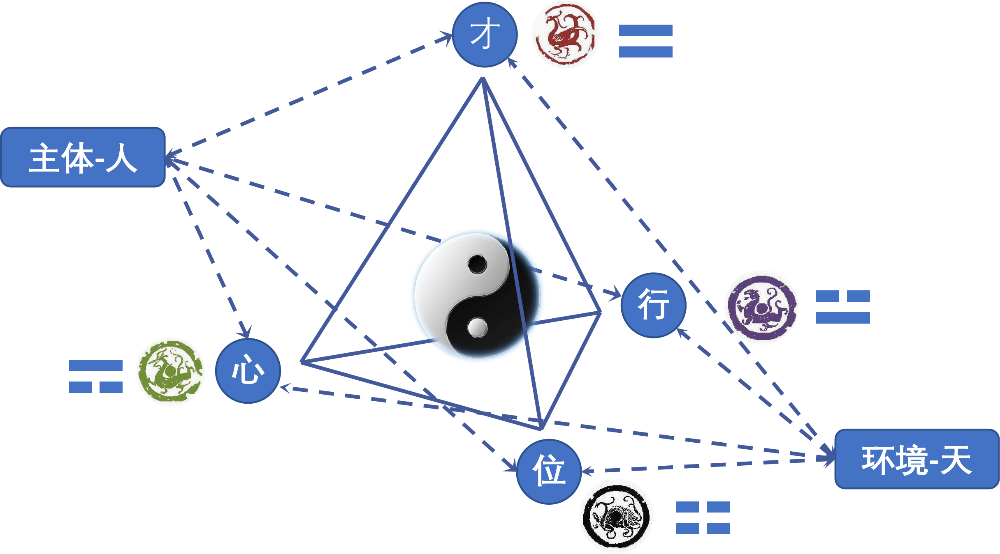

# 四象模型·DSH智能体

孔茨1961年诊断 **管理理论丛林**：科学管理、一般管理、人际关系、社会系统、需求层次、决策理论、经验主义、过程管理、系统管理……学派林立，术语、边界、假设冲突，缺乏统一范式；1980年再探，**丛林更茂密**，权变管理、工作特征、管理角色……等加入，分歧加深。20世纪80年代以后，新理论层出不穷，战略管理、企业文化、全面质量管理、利益相关者、学习型组织、核心能力、精益生产、企业再造、资源基础观、平衡计分卡、知识创造、动态能力、破坏性创新、敏捷管理、蓝海战略、数字化转型、ESG与可持续管理、生态系统战略……等相继涌现，管理学更呈 **多范式碎片化**。

但若改变评价坐标，这种碎片化并不必然意味着管理学只能走向单一范式或永远分裂，而是说明 **西方管理理论缺少一个足够包容的底层架构**。与其他中西方传统和现代管理思想文化不同，**群经之首** 的 **《易经》** 提供了一个灵活多变、具有极度包容性的 **底层架构**，可以将人类文明发展历程所积淀的多范式碎片化思想和理论（当然也包括管理思想和理论）进行 **新的解构和建构**，然后以 **插件-组合** 的方式整合于其中。中南大学戴国斌副教授将《易经》框架做一定简化，生成 **《四象模型》**，使碎片化的管理思想和理论得以在一个 **统一的底层框架** 中，面向 **真实管理世界**，分析和解决现实的 **复杂管理问题**。

进一步看，这与 **DeepSeek Harness** 的 **一切皆插件** 的设计理念有着内在契合。二者的这一共同特点，使得四象模型在通过智能体呈现时，Deepseek Harness的 **技术架构** 赋予四象模型更多的 **AI Native内涵**。也就是说，《四象模型》提供的是包容多范式的底层架构，而DeepSeek Harness提供的是“一切皆插件”的智能体运行框架；前者使管理理论可解构、可建构、可整合，后者使这种整合可在AI原生环境中动态调用、组合与呈现。

**AI推动管理新纪元的到来。** 这个版本的 **DSH四象模型插件**，是这个伟大进程的里程碑式的第一步。后续将在撰写 **《四象模型》专著** 的同时，对四象模型的内涵与框架 **持续优化**；而各种碎片化的管理思想、理论、工具、方法、流程……，将 **面向真实管理世界进行AI Native级别的解构和建构**，继而整合到四象模型中，持续推动DSH四象模型插件的 **迭代更新**。这也意味着中西方传统文化与管理哲学、当代管理思想与实践以及AI文明，将以一种全新的方式共同推动 **AI Native-“AI+管理”** 的持续进程。欢迎包括管理领域在内的各领域学者、实践者、兴趣爱好者参与到这一伟大进程中。

因此，管理学的丛林及其后续，不应只被看作学术部落化或管理时尚化，而是可被重新理解为：**多范式理论等待一个底层操作系统**。以《四象模型》为底层框架，以Deepseek Harness“一切皆插件”为AI Native支撑，各学派不必相互取代，而是能成为 **可解构、可建构、可插拔、可组合模块**，使 **人类一切管理智慧** 如同百川入海达成新的融合，在真实管理世界中实现对话、整合与应用。

<p align="center">
  
</p>

具体地，四象模型把管理问题拆成 **主体 / 环境 / 地位 / 行为 / 才能 / 心态** 六个维度，逐维独立诊断、独立出方案，最后汇总成一份带优先级的行动清单。

地位、行为、才能、心态四要素的归纳，源自管理实践的现象归纳与内在逻辑的统一，并且与太阴、少阴、少阳、太阳的现象表征与运转逻辑有着一致性的匹配。因此将此模型命名为《四象模型》。**主体（人）** 适应 **环境（天）**，顺应天势而成就自我，并通过自我成就推动大势发展，达成主体-环境的匹配（**天人合一**）。具体的操作路径，就是位、才、行、心的循环迭代。

四象模型既是一个分析问题的工具，也是一个解决问题的工具。关键在 **逐维独立诊断**、**独立出方案**，最后才汇总成一份带优先级的 **行动清单**。

适用于 **DeepSeek Harness（桌面端 / Web 端）**。

> **你不需要 clone 本仓库。** 只需从 Releases 下载一个 `.tgz` 安装包，按下面四步安装即可。

## 一、下载安装包

到本仓库的 **Releases** 页面，下载最新版：

| 下载项 | 文件名 |
|---|---|
| 安装包 | `dsh-preset-four-images-model-<版本号>.tgz` |

下载后建议核对完整性。以 1.4.6 为例：

```powershell
Get-FileHash "<你下载的目录>\dsh-preset-four-images-model-1.4.6.tgz" -Algorithm SHA256
```

期望值与字节大小见该 Release 的说明。两者不一致就不要安装。

## 二、安装（四步）

### 第 1 步：装名册库（只需一次）

本插件由多个"具名角色"协作，需要先装名册库：

```
plugin_manager({ action: "install_bundle", target: "dsh-subagent-library" })
```

### 第 2 步：装本插件

把 `<下载目录>` 换成你实际保存 tgz 的位置（**必须是绝对路径**）：

```
plugin_manager({ action: "install_bundle", target: "<下载目录>\dsh-preset-four-images-model-1.4.6.tgz" })
```

装完若提示需要重启 DSH，就重启一次。

### 第 3 步：把角色名册指向插件自带的那份

本插件的 10 个角色文件**随安装包一起装好了，你不需要手工复制任何文件**。
只要告诉名册库去哪里读 —— 在 DSH 的 **设置 → Subagent Library → Entries directory** 填入：

```
%USERPROFILE%\.dsh\profiles\desktop\node_modules\dsh-preset-four-images-model\subagents
```

> Web 端的 profile 名可能不是 `desktop`，把路径里的 `desktop` 换成你的 profile 名即可。
> 保存后**热生效**，不需要重启。

### 第 4 步：确认装好了

让 DSH 执行 `list_subagents`，应当能看到 10 个以 `four-images-` 开头的角色。

## 三、开始使用

1. **新建会话**（已存在的会话不会获得新预设）；
2. 在预设选择器里选择 **四象模型·DSH智能体**；
3. 直接描述你的管理问题，例如："新品导入周期比行业慢一倍，责任说不清。"

父智能体会自动推进四个阶段：主体与环境确认 → 位 / 行 / 才 / 心并行诊断 → 四维方案 → 汇总报告与待验证项。

**一点使用提示**：插件强制「才能」与「心态」分开诊断。若输出把两者并成一条，属不合格，可要求它拆开重写。

## 四、常见问题

**一定要装名册库吗？**
装了效果最好。未装时仍可用，但会退化为"把角色说明直接写进任务里"的方式，流程与判断标准不变、稳定性略差。

**安装后预设选择器里没有卡片？**
多半是没重启，或你打开的是**已有会话**。请重启 DSH 后**新建**一个会话。

**升级到新版本怎么做？**
下载新版本 tgz → 重复第 2 步（同名包会按版本号覆盖）→ 确认第 3 步的目录仍指向 `node_modules\dsh-preset-four-images-model\subagents`。

**怎么卸载？**
```
plugin_manager({ action: "remove_bundle", target: "dsh-preset-four-images-model" })
```

## 五、许可

MIT，见 [LICENSE](./LICENSE)。
