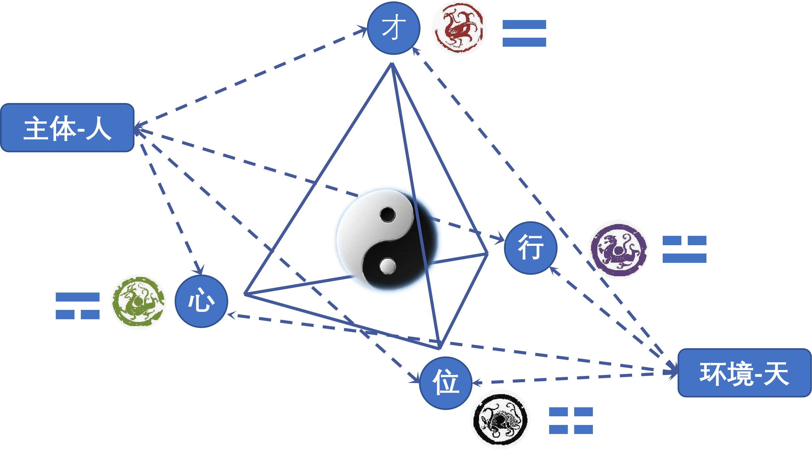

# 四象模型·DSH智能体

孔茨1961年诊断 **管理理论丛林**：科学管理、一般管理、人际关系、社会系统、需求层次、决策理论、经验主义、过程管理、系统管理……学派林立，术语、边界、假设冲突，缺乏统一范式；1980年再探，**丛林更茂密**，权变管理、工作特征、管理角色……等加入，分歧加深。20世纪80年代以后，新理论层出不穷，战略管理、企业文化、全面质量管理、利益相关者、学习型组织、核心能力、精益生产、企业再造、资源基础观、平衡计分卡、知识创造、动态能力、破坏性创新、敏捷管理、蓝海战略、数字化转型、ESG与可持续管理、生态系统战略……等相继涌现，管理学更呈 **多范式碎片化**。

但若改变评价坐标，这种碎片化并不必然意味着管理学只能走向单一范式或永远分裂，而是说明 **西方管理理论缺少一个足够包容的底层架构**。与其他中西方传统和现代管理思想文化不同，**群经之首** 的 **《易经》** 提供了一个灵活多变、具有极度包容性的 **底层架构**，可以将人类文明发展历程所积淀的多范式碎片化思想和理论（当然也包括管理思想和理论）进行 **新的解构和建构**，然后以 **插件-组合** 的方式整合于其中。中南大学戴国斌副教授将《易经》框架做一定简化，生成 **《四象模型》**，使碎片化的管理思想和理论得以在一个 **统一的底层框架** 中，面向 **真实管理世界**，分析和解决现实的 **复杂管理问题**。

进一步看，这与 **DeepSeek Harness** 的 **一切皆插件** 的设计理念有着内在契合。二者的这一共同特点，使得四象模型在通过智能体呈现时，Deepseek Harness的 **技术架构** 赋予四象模型更多的 **AI Native内涵**。也就是说，《四象模型》提供的是包容多范式的底层架构，而DeepSeek Harness提供的是“一切皆插件”的智能体运行框架；前者使管理理论可解构、可建构、可整合，后者使这种整合可在AI原生环境中动态调用、组合与呈现。

**AI推动管理新纪元的到来。** 这个版本的 **DSH四象模型插件**，是这个伟大进程的里程碑式的第一步。后续将在撰写 **《四象模型》专著** 的同时，对四象模型的内涵与框架 **持续优化**；而各种碎片化的管理思想、理论、工具、方法、流程……，将 **面向真实管理世界进行AI Native级别的解构和建构**，继而整合到四象模型中，持续推动DSH四象模型插件的 **迭代更新**。这也意味着中西方传统文化与管理哲学、当代管理思想与实践以及AI文明，将以一种全新的方式共同推动 **AI Native-“AI+管理”** 的持续进程。欢迎包括管理领域在内的各领域学者、实践者、兴趣爱好者参与到这一伟大进程中。

因此，管理学的丛林及其后续，不应只被看作学术部落化或管理时尚化，而是可被重新理解为：**多范式理论等待一个底层操作系统**。以《四象模型》为底层框架，以Deepseek Harness“一切皆插件”为AI Native支撑，各学派不必相互取代，而是能成为 **可解构、可建构、可插拔、可组合模块**，使 **人类一切管理智慧** 如同百川入海达成新的融合，在真实管理世界中实现对话、整合与应用。

<p align="center">
  
</p>

具体地，四象模型把管理问题拆成 **主体 / 环境 / 地位 / 行为 / 才能 / 心态** 六个维度，逐维独立诊断、独立出方案，最后汇总成一份带优先级的行动清单。

地位、行为、才能、心态四要素的归纳，源自管理实践的现象归纳与内在逻辑的统一，并且与太阴、少阴、少阳、太阳的现象表征与运转逻辑有着一致性的匹配。因此将此模型命名为《四象模型》。**主体（人）** 适应 **环境（天）**，顺应天势而成就自我，并通过自我成就推动大势发展，达成主体-环境的匹配（**天人合一**）。具体的操作路径，就是位、才、行、心的循环迭代。

四象模型既是一个分析问题的工具，也是一个解决问题的工具。关键在 **逐维独立诊断**、**独立出方案**，最后才汇总成一份带优先级的 **行动清单**。

适用于 **DeepSeek Harness（桌面端 / Web 端）**，要求 DSH `>= 0.2.1-rc.2`。

> **本插件零第三方依赖**：只引用 DSH 随附插件，不需要安装任何前置插件、不需要复制文件、没有安装脚本、没有构建步骤。

## 一、安装（两步）

### 第 1 步：装本插件

方式 A（推荐，npm 包名）：

```
plugin_manager({ action: "install_bundle", target: "dsh-preset-four-images-model" })
```

也可以在 DSH 的 **设置 → 插件 → 添加插件** 里填 `dsh-preset-four-images-model`。

方式 B（本地 tgz）：把 `<下载目录>` 换成你实际保存 tgz 的位置（**必须是绝对路径**）：

```
plugin_manager({ action: "install_bundle", target: "<下载目录>\dsh-preset-four-images-model-<版本号>.tgz" })
```

装完若提示需要重启 DSH，就重启一次。

### 第 2 步：新建会话

**新建会话**，在预设选择器里选择 **四象模型·DSH智能体**，然后直接描述你的管理问题，例如："新品导入周期比行业慢一倍，责任说不清。"

> **已存在的会话不会获得新预设**——DSH 规定既有会话沿用启动时的插件组合，必须开新会话。

## 二、它会怎么工作

父智能体会自动推进四个阶段：

1. **主体与环境确认**：主体维度（第一维）确认第一主体与利益相关者、产出画像；环境维度输出环境因子与硬约束；
2. **位 / 行 / 才 / 心 并行诊断**：四个诊断子代理各自独立返回结构化 JSON；
3. **四维方案**：位 / 行 / 才 / 心 各自生成方案；
4. **汇总报告**：六维总览表 + 逐维独立成节的详情 + 优先级行动清单 + 待验证项。

**一点使用提示**：插件强制「才能」与「心态」分开诊断。若输出把两者并成一条，属不合格，可要求它拆开重写。

## 三、这个预设里有什么

- **六个维度、四阶段**：主体置首；主体与环境只出确认/约束，不出方案。
- **10 个角色**：主体、环境 + 位/行/才/心 的 A（诊断）与 B（方案）各一个；每个角色独立子代理、独立上下文。
- **工具**：`ask_user_question`（澄清）、`subagent_fast` / `subagent_pro`（派发）、`web_search` / `web_fetch`（环境时效信息）、上下文压缩。缺字段时通过重新派发角色补齐。
- **只读**：预设不提供文件读写、shell、代码执行工具；父智能体与子代理都没有落盘能力。
- **模型分工**：诊断子代理默认用 `deepseek-v4-flash`，方案子代理默认用 `deepseek-v4-pro`；模型 id 可在部署侧改（见「常见问题」）。

## 四、在四象工作台中接入（可选）

本插件同时是 [四象工作台](https://github.com/RootAndSource/dsh-workbench-four-images-model) 的一个扩展：装上工作台后，左侧会出现「四象分析」页面，工作台首页会出现本插件的卡片与「开始四象分析」按钮。

安装工作台（可选容器；本插件不依赖它，没装工作台时照常使用）：

```
plugin_manager({ action: "install_bundle", target: "dsh-workbench-four-images-model" })
```

刷新页面后：

- 左侧「插件页面」分组下出现 **四象分析**；
- 首页出现 **四象模型 · 分析智能体** 卡片与 **开始四象分析** 主操作；
- 「四象分析」页面提供六维速览、推导顺序、提问示例、四阶段说明、报告读法与常见问题；
- 点击 **开始四象分析** 会新建一个绑定本预设的会话，你直接输入管理问题即可。

工作台未安装、被停用时，以上入口自动消失，本预设的会话行为完全不变。工作台与执行技能（skills）插件相互独立：本插件只注册自己的页面/卡片/入口，不读取、不写 skills 的状态。

## 五、常见问题

**需要先装第三方名册类插件吗？**
不需要。1.4.9 起改用 DSH 官方 `subagent` 工具派发，零第三方依赖；角色框架随预设一起分发。

**安装后预设选择器里没有卡片？**
多半是没重启，或你打开的是**已有会话**。请重启 DSH 后**新建**一个会话；再确认 DSH 版本满足 `>= 0.2.1-rc.2`。若使用工作台，请同时确认工作台与本插件都已安装、已启用。

**环境维度不联网 / 搜索结果为空？**
环境维度的时效性事实取决于部署的 Web 搜索能力（`@deepseek-ai/dsh-tool-web`）。没有配置搜索服务时，环境因子需要用户提供，父智能体会把它们标为待验证。

**我的部署里没有 `deepseek-v4-flash` / `deepseek-v4-pro` 怎么办？**
在 profile 的 `cordis.patch.yml` 里覆盖本预置的两个 `tool-subagent` 行，把 `agentOptions.model` 改成你的模型 id，或删掉 `agentOptions` 让子代理继承父会话模型。**DSH 0.2.2 的默认目录已使用 `deepseek-flash`（V4.1 Flash）**；若你的部署只有这个 id，可把两个子代理都指向 `deepseek-flash`，或在部署侧只覆盖 `subagent-fast` 一行。

**工作台里没有「四象分析」页面 / 首页没有卡片？**
确认工作台是 0.3.x、本插件是 1.5.x，且两者都已安装并启用；刷新页面或重启 DSH 后再看。旧版工作台没有这些扩展点。页面内显示「未检测到预设」时，按提示新建会话或重启 DSH。

**升级到新版本怎么做？**
npm 安装的话重新执行第 1 步的 `install_bundle`；tgz 安装的话下载新版本后同法覆盖。同名包只有在**版本号变化**时才会更新（同版本号内容变化需升版重打包，否则 pnpm 会判 `Already up to date`）。

**从 1.4.8 升级要注意什么？**
1.4.9 起不再依赖任何第三方名册插件：如果你以前按旧文档配置过名册目录或第三方名册插件，请删除那份目录配置（旧版随包附带的角色文件目录已不存在）。新版本的角色框架随预置一起分发，不需要额外安装或复制任何文件。详见 [`MANIFEST.md`](./MANIFEST.md) 的 1.4.9 节。

**怎么卸载？**
```
plugin_manager({ action: "remove_bundle", target: "dsh-preset-four-images-model" })
```

## 六、许可

MIT，见 [LICENSE](./LICENSE)。
